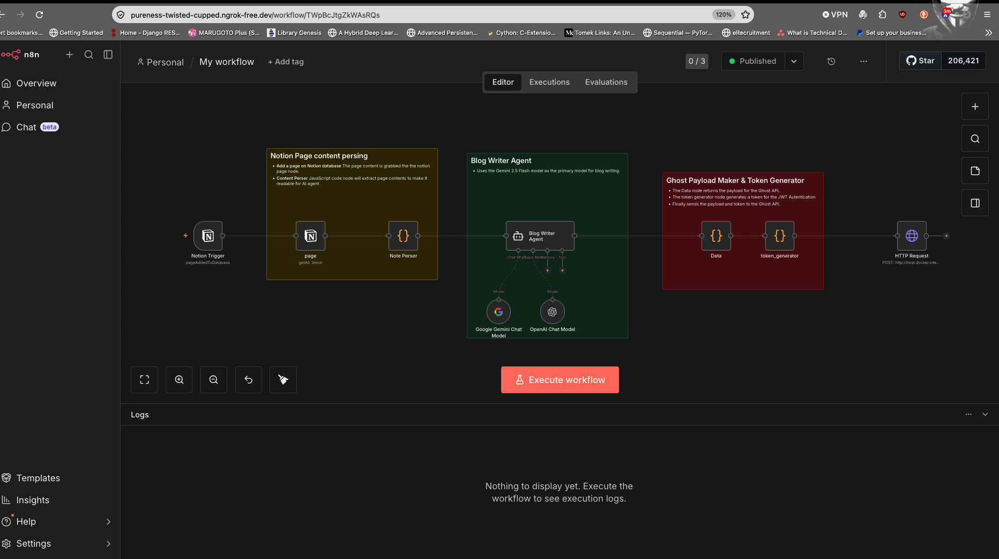

# Notion-to-Blog n8n Workflow Setup



This guide explains how to set up and run the **Notion-to-Blog automation workflow** using Docker Compose. The workflow triggers when a new page is added to a Notion database, uses AI to convert the note into a professional blog post, and publishes it to a Ghost CMS blog.

## How it works

1. **Trigger**: A new page is added to a specified Notion database.
2. **Read note**: The workflow fetches the content of the new Notion page.
3. **AI transformation**: An AI node rewrites/expands the raw note into a polished, professional blog post.
4. **Publish**: The generated blog post is published automatically to your Ghost CMS blog via the Ghost API.

## 1. Prerequisites

Before starting, make sure you have:

- Docker installed and running
- Docker Compose file
- Access to the project folder
- A Notion account with:
  - An integration token (internal integration secret)
  - A database set up for notes, shared with the integration
- A Ghost CMS instance with:
  - Admin API URL
  - Admin API Key
- An AI provider API key (e.g., OpenAI) for content generation

## 2. Start the services

From the project root, run:
```bash
docker volume create n8n_data
```

to create a persistent volume for n8n data storage. This ensures that your workflow data is not lost when the container is stopped or removed. Then you can start the services with Docker Compose.

```bash
docker compose up -d
```

This will start the n8n container and any required services defined in the Compose file.

## 3. Access n8n

Open your browser and visit:

```text
http://localhost:5678
```

If you changed the port in your Compose configuration, use that port instead.

## 4. Import the workflow

Once n8n is running:

1. Log in to the n8n UI
2. Create a new workflow (or open the workspace)
3. Import the workflow JSON provided in this project
4. Verify the nodes are connected in order: **Notion Trigger → AI Blog Generator → Ghost Publish**

## 5. Configure credentials

Add credentials for each connected service:

### Notion
- Add your Notion integration token
- Make sure the target database is shared with the integration
- Set the correct database ID in the Notion Trigger node

### AI Provider (e.g., OpenAI)
- Add your API key
- Configure the prompt/model used to transform notes into blog posts

### Ghost CMS
- Add your Ghost Admin API URL
- Add your Ghost Admin API Key
- Confirm the target blog/site is correct

## 6. Test the workflow

1. Add a new page to your Notion database with a draft note
2. In n8n, click **"Execute Workflow"** to trigger it manually (or wait for the polling trigger)
3. Watch the node output:
   - Confirm the Notion page content is fetched correctly
   - Confirm the AI node returns a well-formatted blog post
   - Confirm the post appears in your Ghost CMS as a draft or published post
4. Fix any errors in credentials or configuration if a node fails

## 7. Common troubleshooting

If the workflow does not run:

- Check the Docker containers are running:

```bash
docker compose ps
```

- Review logs:

```bash
docker compose logs -f
```

- Verify environment variables in the Compose file
- Check that ports are not already in use
- Confirm the Notion integration has access to the target database
- Confirm the Ghost Admin API key/URL are correct and not expired

## 8. Stop the services

To stop the environment:

```bash
docker compose down
```

## 9. Useful notes

- Keep your workflow JSON in version control
- Use environment variables or n8n credentials storage for secrets (Notion token, AI API key, Ghost API key) — never hardcode them
- Back up your workflow regularly
- Consider adding a review/approval step before auto-publishing to Ghost

For more advanced setup, refer to the n8n documentation, Notion API docs, and Ghost Admin API docs.
